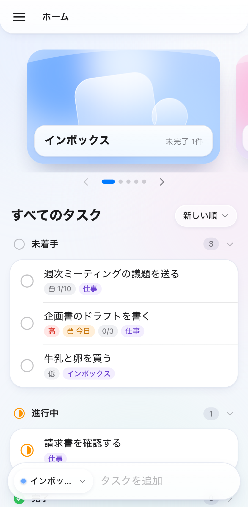
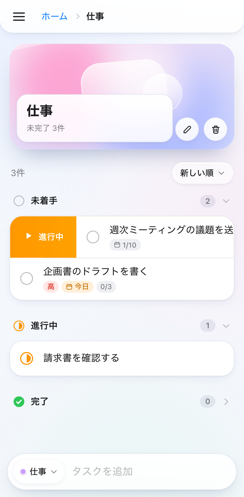
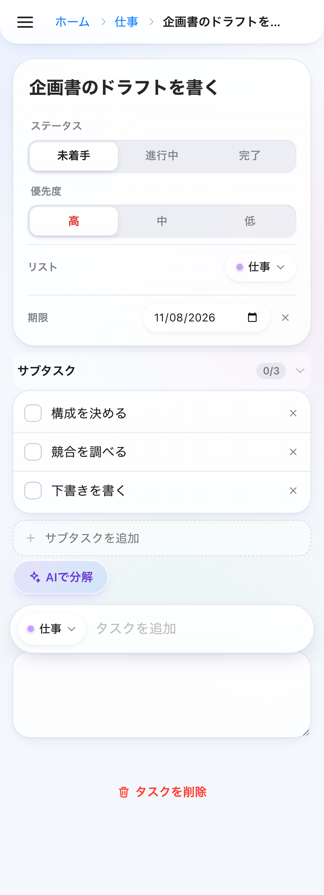
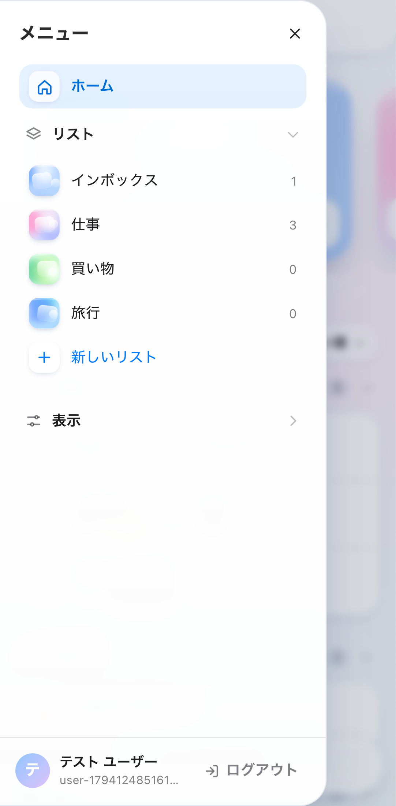
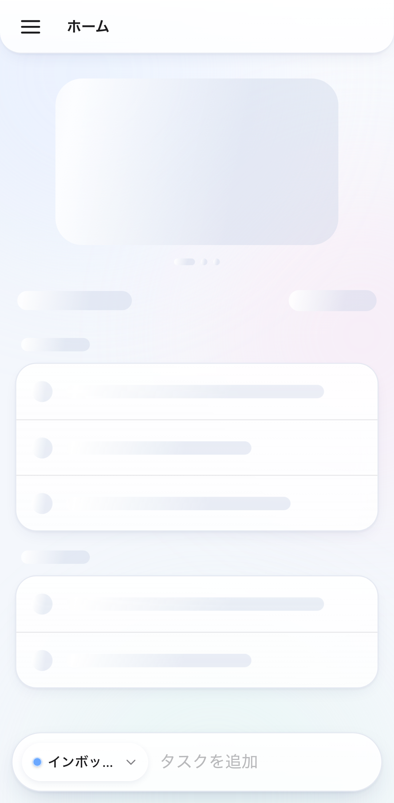
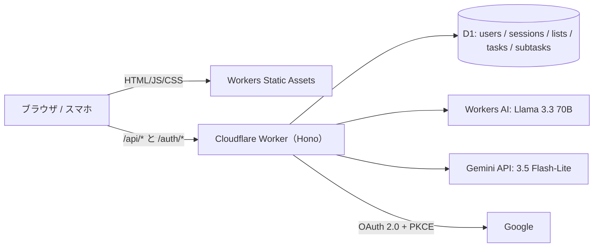

# Glass Tasks

白基調の控えめな Liquid Glass UI で作った、モバイルファーストのタスク管理 Web アプリです。
Cloudflare Workers（API・配信）＋ D1（データベース）＋ Workers AI（サブタスク分解）＋ Gemini（自然文からのタスク追加）で動き、ログインは Google 認証のみです。

| ホーム | スワイプ | タスク詳細 | メニュー | 読み込み中 |
| --- | --- | --- | --- | --- |
|  |  |  |  |  |

## 主な機能

- **即時入力**: 画面下の入力欄は常に表示。JS の読み込み前（静的 HTML の段階）から入力でき、起動後に引き継がれます。PC では起動時に自動フォーカス、`/` か `n` キーでもフォーカス。Enter で連続追加でき、日本語変換確定の Enter では送信しません。
- **スワイプ操作**: タスクを右にスワイプ → 次のステータス（未着手 → 進行中 → 完了 → 未着手）、左にスワイプ → 削除。どちらも「元に戻す」付きの通知が出ます。丸いステータスボタンでも同じ操作ができます。
- **Gemini で追加**: 入力欄に「明日 歯医者に電話 急ぎ」のように書いて ✨ ボタンを押すと、Gemini がタスク名・期限（日付に変換）・優先度に分けて登録します。通常の Enter 追加は AI を待たず即時です。
- **AI でサブタスク分解**: タスク詳細の「AIで分解」で Workers AI が 3〜6 個のサブタスクを提案。選んだものだけ追加できます。
- **全画面スケルトン**: 起動直後（静的 HTML）、セッション確認、ホーム、リスト、タスク詳細、メニュー、AI 提案のすべてに、実際のレイアウトと同じ形のスケルトンを表示します。
- **アニメーション**: ページ遷移（階層の深さに応じて左右にスライド）、リストの増減、スワイプ、チェックの描画、アコーディオン開閉、モーダル/メニューのばね動作、ラジオの選択インジケーター移動、プルダウンの展開、カルーセルの拡大縮小、通知の出入り、背景の光の揺らぎ。OS の「視差効果を減らす」設定に従います。
- **余計な文言なし**: 画面に出る文字は機能ラベルのみ（テストで検査しています）。

### 使っている UI 部品

| 部品 | 使っている場所 |
| --- | --- |
| ハンバーガーメニュー | 左上の 3 本線ボタン。押すとメニュー（ホーム・リスト一覧・表示設定・アカウント）が左から出ます。開くと × に変形 |
| パンくずリスト | 上部に「ホーム ＞ リスト名 ＞ タスク名」。押すと上の階層へ戻ります |
| カルーセル | ホームのリスト一覧（カバー画像を横スワイプで切り替え）、リスト作成/編集時のカバー画像選択 |
| モーダル | リストの作成・編集、AI 分解、削除確認。開いている間は背面が操作できません（`inert` ＋フォーカス閉じ込め、Esc/背景タップで閉じる） |
| アコーディオン | ステータスごとのタスクのまとまり（未着手/進行中/完了）、タスク詳細のサブタスク・メモ、メニューの「リスト」「表示」。開閉状態は保存されます |
| ラジオボタン | タスクのステータス（未着手/進行中/完了）・優先度（高/中/低）、メニューの「完了したタスク：表示/非表示」 |
| プルダウンメニュー | 並び替え（新しい順/期限順/優先度順）、入力欄の追加先リスト、タスク詳細のリスト移動。キーボード（↑↓/Enter/Esc）対応、画面下では上に開きます |

## 技術構成と選定理由

| 分類 | 採用技術 | 選定理由 |
| --- | --- | --- |
| 実行基盤 | **Cloudflare Workers** | 世界中のエッジで動き、利用者に近い場所で応答できるため、スマホ回線でも待ち時間が短い。API と画面配信を 1 つの Worker にまとめられ、デプロイも 1 コマンド。無料枠が大きい |
| 画面配信 | **Workers Static Assets** | ビルドした画面ファイルを Worker と同じデプロイで配信できる。SPA のフォールバック（どの URL でも index.html を返す）を設定だけで実現でき、`/api/*` と `/auth/*` だけ Worker を通すので静的ファイルは高速 |
| データベース | **Cloudflare D1** | Workers から直接使える SQLite。ユーザー・リスト・タスク・サブタスクの関係データを外部キーや集計（ステータス別件数）で素直に扱える。セッション削除（ログアウト）が即時に反映される強い一貫性が必要なため、結果整合の KV ではなく D1 にセッションも保存 |
| AI | **Cloudflare Workers AI**（`@cf/meta/llama-3.3-70b-instruct-fp8-fast`） | 要件どおり Cloudflare 内で完結し、API キー管理が不要（Worker のバインディングで呼べる）。このモデルは JSON モード（スキーマ指定の出力）対応で、日本語の短い指示文も安定して生成できるため、提案をそのまま安全に解析できる。非推奨予定も出ていない（2026-11 時点）。モデルは `AI_MODEL` 変数で差し替え可能 |
| AI（自然文の解析） | **Gemini API**（`gemini-3.5-flash-lite`） | 「明日」「来週月曜」などの相対的な日付を今日の日付から正しく解釈でき、JSON スキーマ指定の構造化出力で結果を安全に取り込める。Flash-Lite は応答が速く安価で、入力欄の操作感を損なわない。安定版で終了予定なし（2026-11 時点）、AI Studio の無料枠でも使える。Workers AI（分解）と役割を分け、得意な処理にそれぞれを使う。モデルは `GEMINI_MODEL` で変更可能 |
| API フレームワーク | **Hono** | Workers 向けに作られた軽量フレームワーク。ルーティング・Cookie・セキュリティヘッダーが揃っていて依存が少なく、起動が速い |
| 認証 | **Google OAuth 2.0 / OpenID Connect（自前実装）** | 要件の「Google 認証のみ」。Web Crypto だけで実装でき追加ライブラリ不要。state（CSRF 対策）と PKCE（S256）を必須にし、セッション Cookie は HttpOnly・SameSite=Lax・HTTPS では Secure。DB にはトークンの SHA-256 だけを保存。パスワードは一切扱わない |
| 画面 | **React 19 ＋ TypeScript** | 部品（モーダル・カルーセル等）を再利用しやすく、型で API とのずれを防げる。採用例と情報量が最も多い |
| ビルド | **Vite** | 開発時の即時反映とビルドが速い。設定がほぼ不要 |
| アニメーション | **Motion（旧 Framer Motion）** | ばね物理・ドラッグ（スワイプ）・レイアウト変化・退場アニメーションを宣言的に書け、Apple 風の自然な動きを少ないコードで実現できる。「視差効果を減らす」設定にも一括対応 |
| データ取得 | **TanStack Query** | キャッシュ・再取得・読み込み状態（スケルトン表示の判定）を一元管理。楽観的更新でスワイプや追加が通信を待たずに即反映され、失敗時は自動で元に戻せる |
| ルーティング | **wouter** | 約 2KB と軽く、モバイルの読み込みを重くしない。必要な機能（パス引数・履歴）は十分 |
| スタイル | **素の CSS（CSS 変数）** | すりガラス表現（`backdrop-filter`・光沢・影）を細かく調整するため、ユーティリティ CSS より直接書くほうが見通しがよい。ビルド依存も増えない |
| テスト | **Playwright** | 実際のブラウザ（Chromium と WebKit＝Safari のエンジン）を操作してテストできる。スマホ（タッチ・画面サイズ）と PC の両方を再現でき、マウスのドラッグや実タッチ入力でスワイプも検証できる |
| CI | **GitHub Actions** | push のたびに 3 種類のブラウザで全テストを自動実行。リポジトリと同じ場所で完結 |

### 構成図



### ディレクトリ

```
worker/        Cloudflare Worker（Hono）: auth.ts（Google 認証）, api.ts（REST API）, ai.ts（Workers AI）, gemini.ts（Gemini）
src/           画面（React）: components/（UI 部品）, pages/（各画面）, hooks.ts（データ取得）
migrations/    D1 のテーブル定義
public/        カバー画像・アイコン・PWA マニフェスト
tests/e2e/     Playwright のテスト, tests/mock-google.mjs（テスト用の Google OAuth・Gemini 模擬サーバー）
```

## セキュリティ

- すべての API はログイン必須。他人のデータは常に「存在しない（404）」として扱います（テストで確認）。
- 書き込み系リクエストは `Origin` ヘッダーが自サイトと一致しないと 403（CSRF 対策）。さらに JSON 以外は受け付けません。
- OAuth は state と PKCE を検証。セッションは 30 日（使うたびに延長）、ログアウトで DB から即削除。
- `secureHeaders` でセキュリティヘッダーを付与。秘密情報（Google のクライアントシークレット）は Worker のシークレットに保存し、リポジトリには含めません。

## テスト

実ブラウザで 3 種類の環境を自動テストします。

| プロジェクト | ブラウザ | 内容 |
| --- | --- | --- |
| `mobile-chrome` | Chromium（Pixel 7 相当、タッチ） | CDP による実タッチ入力のフリックも検証 |
| `mobile-safari` | WebKit（iPhone 15 相当） | Safari エンジンでの表示・操作 |
| `desktop-chrome` | Chromium（1280×860） | キーボード操作・自動フォーカス |

テストは本物と同じ認証フロー（リダイレクト → 同意 → コールバック → トークン交換 → ユーザー情報）を、ローカルの Google 模擬サーバー（`tests/mock-google.mjs`）に向けて実行します。模擬サーバーもクライアント認証・redirect_uri・PKCE を検証します。Workers AI はテスト環境だけ決まった応答を返すモードで、Gemini は同じ模擬サーバー上の generateContent 互換エンドポイント（API キーのヘッダーと構造化出力の指定を検証）に向けて動かします。

主な検証項目: Google ログイン/ログアウト/キャンセル/不正な state、未認証・別オリジンの拒否、ユーザー間のデータ分離、即時入力（自動フォーカス・連続追加・下書き保持・JS 読み込み前の入力の引き継ぎ・リスト読み込み前の追加先）、スワイプ（右/左/短い/タッチ/元に戻す/保存）、ハンバーガーメニュー、パンくず、カルーセル、モーダル（背面操作不可・フォーカス閉じ込め・Esc/背景で閉じる）、アコーディオン、ラジオ、プルダウン（マウス/キーボード）、AI 分解（成功・失敗・再試行）、Gemini で追加（期限・優先度の読み取り、表示中リストへの追加、失敗時に入力を残す）、全画面のスケルトン、横はみ出しなし、宣伝文句なし。

```bash
npm ci
npx playwright install chromium webkit
npm run test:e2e
```

## ローカル開発

```bash
npm ci
cp .dev.vars.example .dev.vars   # Google のクライアント ID/シークレットを記入
npm run db:migrate:local
npm run dev                      # http://localhost:5173
```

Google Cloud Console の OAuth クライアントに、承認済みリダイレクト URI として `http://localhost:5173/auth/callback` を登録してください。Workers AI は `wrangler login` 済みならローカル開発でも本物が呼ばれます。

## デプロイ（Cloudflare）

1. `npx wrangler login`
2. D1 を作成し、表示された `database_id` を `wrangler.jsonc` に設定
   ```bash
   npx wrangler d1 create glass-tasks
   ```
3. Google Cloud Console で OAuth クライアント（ウェブアプリケーション）を作成し、リダイレクト URI に `https://<あなたのWorker>.workers.dev/auth/callback` を登録
4. `wrangler.jsonc` の `GOOGLE_CLIENT_ID` を設定し、シークレットを登録（Gemini のキーは [Google AI Studio](https://aistudio.google.com/apikey) で無料発行）
   ```bash
   npx wrangler secret put GOOGLE_CLIENT_SECRET
   npx wrangler secret put GEMINI_API_KEY
   ```
5. デプロイ（ビルド → D1 マイグレーション → 公開）
   ```bash
   npm run deploy
   ```
